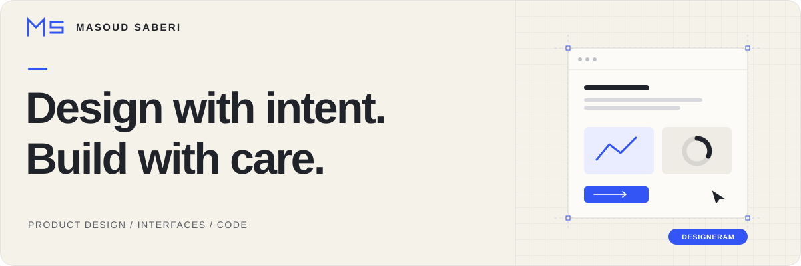
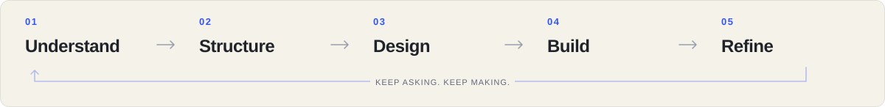

<picture>
  <source media="(prefers-color-scheme: dark)" srcset="assets/header-dark.svg">
  <source media="(prefers-color-scheme: light)" srcset="assets/header-light.svg">
  
</picture>

# Hello, I’m Masoud.

**Product & interface designer · Designeram**

My work connects product thinking, visual design, and practical frontend exploration. I work across UX/UI, branding, motion, and the web—with an eye for clear structure, thoughtful details, and experiences that feel good to use.

**[Explore my portfolio ↗](https://designeram.ir/)** &nbsp; · &nbsp; [LinkedIn](https://www.linkedin.com/in/designeram-ir/) &nbsp; · &nbsp; [Email](mailto:masoudsaberi10@gmail.com) &nbsp; · &nbsp; [Telegram](https://t.me/Masoudsaberi_8)

## Life beyond the graph

If my contribution graph is quiet, the rest of life probably isn’t.

<picture>
  <source media="(prefers-color-scheme: dark) and (max-width: 1024px)" srcset="assets/life-commit-mobile-dark.svg">
  <source media="(max-width: 1024px)" srcset="assets/life-commit-mobile-light.svg">
  <source media="(prefers-color-scheme: dark)" srcset="assets/life-commit-dark.svg">
  
</picture>

**Design. Code. Train. Lead. Earn.** Different kinds of effort. Same commitment to moving forward.

## How I approach the work

<picture>
  <source media="(prefers-color-scheme: dark) and (max-width: 1024px)" srcset="assets/process-mobile-dark.svg">
  <source media="(max-width: 1024px)" srcset="assets/process-mobile-light.svg">
  <source media="(prefers-color-scheme: dark)" srcset="assets/process-dark.svg">
  <source media="(prefers-color-scheme: light)" srcset="assets/process-light.svg">
  
</picture>

Understand the problem. Give it a clear structure. Design deliberately. Build something tangible. Refine what matters.

---

**Have something worth making clearer?** [Let’s talk ↗](mailto:masoudsaberi10@gmail.com)
